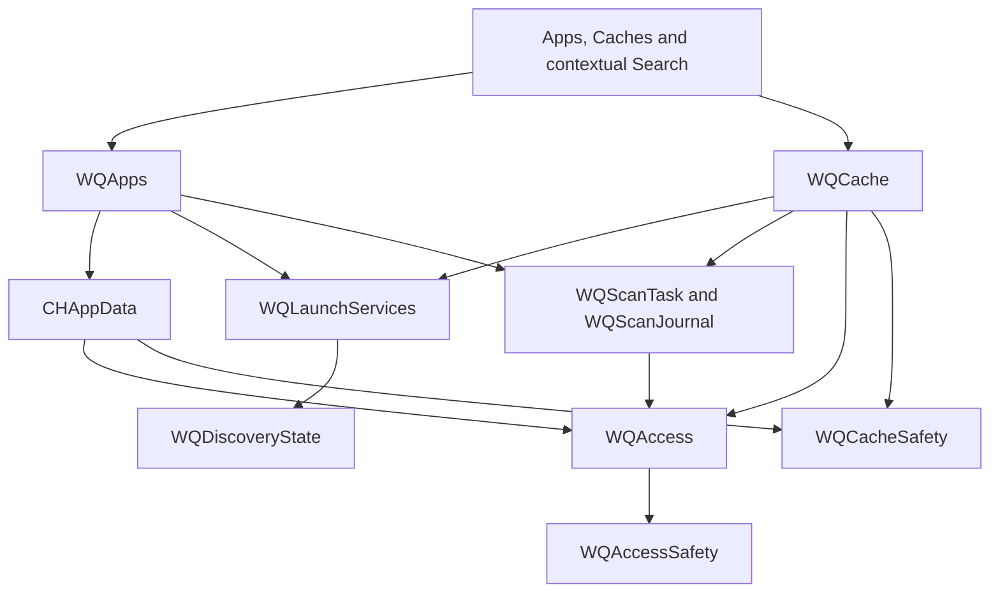

# Architecture

Charony retains the access, identity, scanning and deletion primitives from WQ Files stable v0.9.18. The application exposes Apps and Caches through a native UIKit shell.

## Module layout

| Component | Responsibility |
| --- | --- |
| `main.m` | Scene setup, two tabs, contextual `UISearchTab`, startup checkpoint preparation and patched-build handling |
| `WQApps.m` | Accessible-app listing, identity-aware filters, measurement and confirmed per-app clearing |
| `WQCache.m` | Fixed cache/tmp and crash-report discovery, manual selection, confirmed batches and cancellation |
| `CHAppData.m/h` | Selected application-container policy, part snapshots, preflight, root-preserving purge and postcondition checks |
| `WQAccess.m/h` | Signer-selected App Group access, worse_query, container discovery, read helpers, measurement, cancellation and descriptor-based purge |
| `WQAccessSafety.h` | Access-cache swap/recovery, no-follow descriptors, protected locks, path/identifier grammar, LiveContainer mapping and patched-build detection |
| `WQCacheSafety.h` | Lexical, canonical and no-symlink checks; exact application/extension cache-parent policy |
| `WQAppsSupport.h` | Bundle-ID grammar for application identity |
| `WQLaunchServices.m/h` | Container identity/name hints and bundle paths, with bounded parsing and ambiguity checks |
| `WQScanTask.m/h`, `WQScanJournal.h` | Scan generations, cancellation, pause, lifecycle suspension and interrupted-task/inode recovery |
| `WQDiscoveryState.m/h` | Process-local discovery hints and layout offsets |
| `WQUI.m/h` | Serial mutation queue, cross-tab operation reservation, scan yielding, lifecycle handling, native alerts, bounded text styles, offline icons and progress UI |
| `WQLocalization.m/h` | English string/format compatibility for retained error and interface code |

[`scripts/sources.sh`](scripts/sources.sh) is the compile inventory. The build explicitly requests UIKit, Foundation and Security. Apple framework auto-linking also loads CoreFoundation and CoreGraphics, alongside libSystem and the Objective-C runtime. There are no third-party runtime SDKs.

## Destructive operations

App clearing uses the retained permanent-clear purge engine and limits it to one selected application UUID's `Documents`, `Library` and `tmp`. Cache cleaning accepts fixed application/extension cache and temporary paths, plus the two upstream crash-report directories.

Both entry points reserve one mutation operation on the main thread and execute on the serial I/O queue. They revalidate selected scope and identity, reject changed or inaccessible targets, preserve required roots and report partial failures. Crash selections start empty. App clearing does not target App Groups, keychain or general system containers.

The full path, identity, symlink, cancellation and failure model is documented in [docs/SAFETY.md](docs/SAFETY.md).

## Scan state

- Both tabs wait for explicit Refresh; an interrupted scan offers Resume in the menu
- Pause/resume and foreground/background gates preserve unfinished work
- Completed rows, sizes and discovery results remain process-local; completed-scan timestamps are unnecessary and removed
- Minimal task, measurement and inode checkpoints resume interrupted scans
- Completion removes recovery state when safe; cleanup failures produce an ephemeral warning
- Startup sanitizes legacy completed state and both known tasks before workers begin
- Orphaned checkpoints are pruned after seven days

Checkpoint creation, reads, atomic publication and removal use no-follow directory descriptors. Unexpected directories are preserved. This is operational recovery state, not activity history.

## Retained shared code

Some upstream files previously served removed features. Their required shared portions remain:

- `WQAccess` keeps descriptor purge, sandbox access and read helpers used by Apps/Caches
- `WQAccessSafety.h` keeps the App Group cache-swap protocol and directory-creation helpers needed for safe checkpoint storage
- `WQUI` keeps serial I/O, lifecycle handling and offline icon fallback
- InternalDaemon discovery remains necessary to find lsd's LaunchServices database; it is not exposed as a browser
- Full-scan cancellation remains covered by the native ownership/interruption fixtures
- `WQAppsSupport.h` keeps bundle-ID validation
- `WQLocalization` keeps English formatting so retained error paths do not require a new implementation

The access-cache preserved directory and swap marker protect interrupted access setup. They are not app-data backups. Removing backup/restore did not remove this recovery protocol.

## Removed capabilities

| Area | Removed components |
| --- | --- |
| General file management | Arbitrary-path navigation and generic create/edit/copy/move/rename APIs |
| Backup and restore | Backup stores, imports/exports, restore manifests/journals, `WQTrash` and related UI |
| Viewers and editors | Plist, SQLite, hex, syntax and media-stream modules and their exclusive helpers |
| Archives and sharing | `WQArchive`, `WQSharing`, `WQWebServer` and ZIP/Wi-Fi interfaces |
| Customization | `WQTheme`, themes, custom inspectors/targets, non-English localization resources |
| History and diagnostics | Recent/Favorites, activity history, settings/log interfaces, `WQHealth` report collection and touch traces |
| Updates and resources | Updater/catalog scripts, old release notes, examples, screenshots and upstream branding assets |
| Build dependencies | JavaScriptCore, UniformTypeIdentifiers, sqlite3 and zlib links |

Feature-exclusive source, resources, build references and tests were physically removed. Shared safety tests remain. The patched-build check and current access-recovery indication were retained before removing `WQHealth`.

## UIKit and fixture scope

Apps/Caches use native list content, Refresh and ellipsis menus. `UISearchTab` moves the same controller between navigation stacks; Search dismissal finishes before context restoration or confirmation presentation. Captured app/batch identities remain unchanged. UIKit's compact horizontal trait keeps native tabs at the bottom on iPad. Window/view text limits cap application typography at normal size while allowing smaller sizes.

The screenshot host and capture scripts/job were removed. Required UIKit fixtures retain real disposable clears, captured batch actions, cancellation, concurrency refusal, deferred outcomes, conditional access recovery, Search restoration and process-relaunch recovery. Layout assertions inspect rendered labels with system accessibility text enabled; no generated images are required.

## Native icon and build evidence

`icons/AppIcon.icon` contains separate SVG moon, terrain and crater layers. `actool` compiles native vector groups and Light/Dark/tintable image stacks into `Assets.car`; `verify_icon.py` rejects a flattened catalog. Native `ictool` renders explicit Default, Dark, Clear Light/Dark and Tinted Light/Dark previews. The AppKit renderer regression runs only on macOS and is not linked into the application. Simulator fixtures install the same asset and verify metadata/icon registration alongside existing Light/Dark behavior.

CI emits `charony-build.json` and `charony.ipa.sha256` only after required checks. The manifest records clean checkout revision/tree and actual IPA/executable/catalog hashes and metadata; it does not infer arbitrary IPA provenance or validate a final Apple profile. Source and compiled-binary privacy gates remain separate. Final Windows provisioning and actual device appearance/access require the read-only procedure.

## Source provenance

The baseline is pinned to `e44cd0ef226305bc265c8d7a15607ec49ceb4368` in [`tests/upstream-baseline.json`](tests/upstream-baseline.json). Its archive and all 147 file hashes, sizes and executable modes were compared with the trusted stable Git tree before independent history was created.

[`scripts/baseline_source.py`](scripts/baseline_source.py) verifies the archive and complete inventory before extracting into disposable validation storage. The unchanged upstream runner executes there. Nine exact safety helpers are compared through [`tests/fixtures/upstream-access-safety.json`](tests/fixtures/upstream-access-safety.json), with pinned provenance and checksum. Neither baseline commits nor the downloaded source are included in the application.

A focused comparison with upstream v0.9.19 retained its single-word application-ID fix and Apple-only fallback-icon keyword matching. The new App Store icon client and Settings were excluded. The access, discovery, scan and purge reference remains stable v0.9.18, with Charony's stricter boundaries intact.

See [NOTICE.md](NOTICE.md) for licensing and attribution, and [TESTING.md](TESTING.md) for actual validation and open gates.
