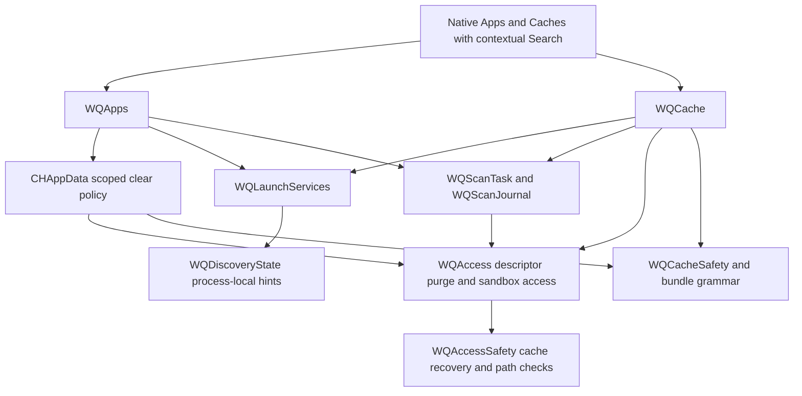

The implementation starts from WQ Files stable v0.9.18, commit e44cd0ef226305bc265c8d7a15607ec49ceb4368, with build 106. The initial fork HEAD was 985cf765cdf3bd4cb88da15de3f7d928664efae6, eight commits later with build 110. Its differences touched Info.plist, build.sh and main.m. Stable contents were restored into the clean existing checkout before reduction. A stable-tree diff was empty at that point. Published history and remote refs were preserved. The implementation and focused review used no remote Git writes or workflow operations. Subsequent development-branch/PR/Actions and one-time independent-history authorization is scoped in AGENTS.md and the specification. HISTORY.md records preservation and provenance without importing inherited commits into the new history.

Compile-time and runtime dependencies were inspected before removal. The original Apps controller combined listing, size measurement, clearing, backups, imports and restore journals. Caches combined fixed targets, custom targets, selection and cleaning. WQUI combined icon lookup, serial I/O, scan lifecycle and product styling. WQAccess combined sandbox access, generic backed-up file mutation, scanning and descriptor-based purge. The retained low-level access-cache protocol preserves interrupted swaps rather than deleting preserved App Group data.

| Retained code | Necessity and change |
| --- | --- |
| WQAccess.m/h | Retains signer-selected App Group access, worse_query, identity lookup, read helpers, container discovery, cancellation and measurement. Removes generic file creation/editing/copy/move/rename, backup stores and deletion APIs. Removes logs and diagnostic sampling summaries. Keeps the existing descriptor purge with per-entry selected-target validation and additional ancestry checks. |
| WQAccessSafety.h | Retains cache swap/recovery, no-follow descriptors, protected lock handling, path grammar, identifier parsing, LiveContainer group mapping and patched-build detection. Access-cache primitives are compared byte-for-byte with the baseline in a portable test. Removes backup stamp helpers. The original no-follow directory-creation helpers are retained for descriptor-based checkpoint storage. |
| WQCacheSafety.h | Retains lexical/canonical/no-symlink checks. Adds exact application/extension parent policy for production cleaning. Custom cache target helpers are deleted. Test-only fixture roots exist under a compile-time guard. |
| WQAppsSupport.h | Retains only the bundle-ID grammar used to validate app identity. Backup, restore and import helpers are deleted. |
| CHAppData.m/h | Scopes clearing to one selected application UUID under the exact application-data parent. Snapshots part identities, validates all targets before and during purge, preserves roots, verifies emptiness and reports partial failure. Reuses the upstream purge engine. |
| WQLaunchServices.m/h | Needed to discover and label containers when iOS refuses metadata, and to resolve names, icons and reliable install state. Retains bounded binary parsing, ambiguity checks and identity invalidation. Diagnostic summaries and logging are removed. Discovery hints and layout offsets are process-local through WQDiscoveryState. |
| WQScanTask.m/h and WQScanJournal.h | Retain main-thread generations, cancellation, manual pause, foreground suspension and incomplete inode/measurement recovery. Persisted completed rows and timestamps are removed. Completion removes task/measurement state and surfaces cleanup failures. Inode journals are removed by the scan engine when completed. |
| WQUI.m/h | Retains serial mutation I/O, scan queue yielding, lifecycle suspension, native alerts, progress header and upstream app icon fallback. Adds a main-thread reservation across the two mutation entry points. Removes device diagnostic strip, preferences, themes, prism styling and tab badge animation. |
| WQLocalization.m/h | Minimal English string/format compatibility helpers avoid rewriting tested safety errors. Translation lookup, language preferences and all .lproj resources are removed. |
| main.m | New native scene/tab shell. UISearchTab temporarily hosts the currently selected controller. Known patched builds display a current capability failure. Full inode scans require an ephemeral confirmation. |

WQHealth is removed after retaining the patched-build check and direct access-cache failure indication in the reduced access path. Its broad health report and collection interface are excluded. No removed-feature module remains whole. The retained icon fallback and read helpers serve app identity presentation. Shared safety functions remain available solely to the approved controllers and fixture tests.

App clearing retains the stable Clear Without Backup intent and its Documents/Library/tmp scope. It strengthens selection checks around the retained purge engine. Caches retain upstream fixed target enumeration, crash-report whitelist, per-target identity records, whole-batch preflight and cancellation. Both mutation entry points reserve a single operation on the main thread and execute on the serial I/O queue. Cache selections start empty, including crash reports. Full app clearing never targets App Groups or other system containers.

Destructive walks still face uncooperative external writers and operating-system behavior. Final race windows cannot be proven away by source checks. Native fixture execution, independent review and physical disposable-data validation remain required. TESTING.md records those open gates.

The old UIImage fallback can display service symbols for unavailable icons. It performs local UIKit/LaunchServices lookup. The app links only UIKit, Foundation and Security. JavaScriptCore, UniformTypeIdentifiers, sqlite3 and zlib build links are removed. No third-party runtime SDK is added. A flat generated Charon moon is the development icon. Layered Icon Composer appearances are incomplete.

Physical cleanup is recorded below. The original stable tree contained 147 tracked files. 113 original paths are deleted. The prepared tree including independent-history validation contains 66 files, with 34 original paths retained or adapted and 32 added files. The 113 deleted paths remain listed below. The authoritative source specification is copied into the repository for review. The preserved external Git bundle supports historical source comparisons. The new history keeps source provenance through the pinned baseline manifest and test-only helper fixtures. Full baseline source is downloaded into disposable validation storage and is excluded from the application.

Obsolete editor/viewer/backup/archive/localization/release tests are removed with their implementations. The purge subset of WQAccessTreeTests is preserved in WQPurgeTests. Access-cache, measurement, shared-scan lifecycle, inode checkpoint, process recovery, cache ancestry and LaunchServices suites remain. Completed-result recovery expectations change to match the approved persistence policy. No failed native test was observed and then deleted to obtain a passing build. Native checks have not run here.

Deleted baseline paths follow.

- `RELEASE_NOTES_0.6.md`
- `RELEASE_NOTES_0.7.md`
- `RELEASE_NOTES_0.8.md`
- `RELEASE_NOTES_0.9.1.md`
- `RELEASE_NOTES_0.9.10.md`
- `RELEASE_NOTES_0.9.11.md`
- `RELEASE_NOTES_0.9.12.md`
- `RELEASE_NOTES_0.9.13.md`
- `RELEASE_NOTES_0.9.14.md`
- `RELEASE_NOTES_0.9.15.md`
- `RELEASE_NOTES_0.9.16.md`
- `RELEASE_NOTES_0.9.17.md`
- `RELEASE_NOTES_0.9.18.md`
- `RELEASE_NOTES_0.9.2.md`
- `RELEASE_NOTES_0.9.3.md`
- `RELEASE_NOTES_0.9.4.md`
- `RELEASE_NOTES_0.9.5.md`
- `RELEASE_NOTES_0.9.6.md`
- `RELEASE_NOTES_0.9.7.md`
- `RELEASE_NOTES_0.9.8.md`
- `RELEASE_NOTES_0.9.9.md`
- `RELEASE_NOTES_0.9.md`
- `WQArchive.h`
- `WQArchive.m`
- `WQCore.h`
- `WQCore.m`
- `WQDir.h`
- `WQEditing.h`
- `WQHealth.h`
- `WQHealth.m`
- `WQHexViewer.h`
- `WQHexViewer.m`
- `WQHexViewerHelpers.h`
- `WQInspector.h`
- `WQInspector.m`
- `WQMediaStream.h`
- `WQMediaStream.m`
- `WQPlistEditor.h`
- `WQPlistEditor.m`
- `WQPlistEditorSupport.h`
- `WQSQLiteSave.h`
- `WQSQLiteSave.m`
- `WQSQLiteSupport.h`
- `WQSQLiteViewer.h`
- `WQSQLiteViewer.m`
- `WQSharing.h`
- `WQSharing.m`
- `WQSyntax.h`
- `WQSyntax.m`
- `WQTheme.h`
- `WQTheme.m`
- `WQTrash.h`
- `WQTrash.m`
- `WQWebServer.h`
- `WQWebServer.m`
- `ar.lproj/Localizable.strings`
- `de.lproj/Localizable.strings`
- `en.lproj/Localizable.strings`
- `es.lproj/Localizable.strings`
- `examples/inspectors/JSON Summary/inspect.js`
- `examples/inspectors/JSON Summary/manifest.json`
- `examples/inspectors/Plist Keys/data.json`
- `examples/inspectors/Plist Keys/inspect.js`
- `examples/inspectors/Plist Keys/manifest.json`
- `icons/AppIcon1024-dark.png`
- `icons/AppIcon1024-tinted.png`
- `icons/AppIcon1024.png`
- `icons/src/make_appearance_icons.py`
- `it.lproj/Localizable.strings`
- `ja.lproj/Localizable.strings`
- `ko.lproj/Localizable.strings`
- `pl.lproj/Localizable.strings`
- `pt-BR.lproj/Localizable.strings`
- `ru.lproj/Localizable.strings`
- `screenshots/ipad-home.webp`
- `scripts/update_source.py`
- `source.json`
- `tests/WQAccessCopyTests.m`
- `tests/WQAccessMutationTests.m`
- `tests/WQAccessTreeTests.m`
- `tests/WQAppsCopyTests.m`
- `tests/WQAppsSupportTests.m`
- `tests/WQArchiveTests.m`
- `tests/WQCoreTests.m`
- `tests/WQHexViewerHelpersTests.m`
- `tests/WQInspectorTests.m`
- `tests/WQLocalizationTests.m`
- `tests/WQMediaStreamTests.m`
- `tests/WQPlistEditorSupportTests.m`
- `tests/WQSQLiteSaveTests.m`
- `tests/WQSQLiteSupportTests.m`
- `tests/WQScanUITests.m`
- `tests/WQSyntaxTests.m`
- `tests/WQTrashTests.m`
- `tests/browser_ui_regressions.py`
- `tests/run_access_safety_tests.sh`
- `tests/run_apps_tests.sh`
- `tests/run_hex_helpers_tests.sh`
- `tests/run_launchservices_tests.sh`
- `tests/run_localization_tests.sh`
- `tests/run_plist_tests.sh`
- `tests/run_tests.sh`
- `tests/test_build.py`
- `tests/test_localization.py`
- `tests/test_release_policy.py`
- `tests/test_scan_lifecycle.py`
- `tests/test_update_source.py`
- `th.lproj/Localizable.strings`
- `themes/midnight.wqtheme`
- `themes/sunset.wqtheme`
- `tr.lproj/Localizable.strings`
- `vi.lproj/Localizable.strings`
- `zh-Hans.lproj/Localizable.strings`

The focused review and subsequent safety fixes are recorded in IMPLEMENTATION_REVIEW.md. Checkpoint creation/read/publication/cleanup now use no-follow directory descriptors. This requires retaining the original directory-creation helper pair despite removal of generic file-manager APIs.
